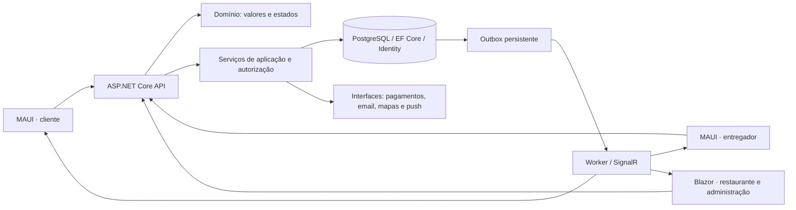
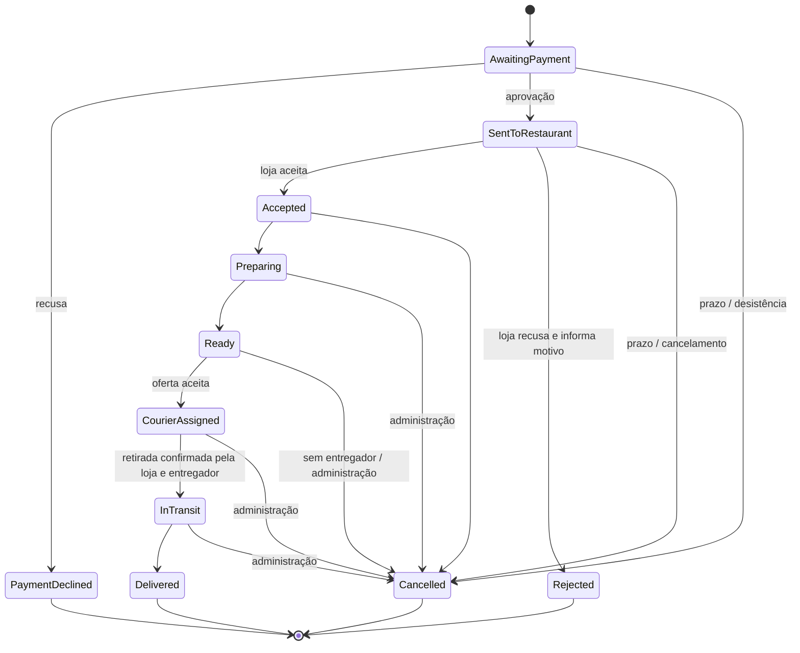

# Arquitetura e decisões

Monólito modular: uma API e um banco transacional. Interfaces móveis e web compartilham contratos e cliente HTTP. Serviços de aplicação ficam na infraestrutura, próximos ao EF, mantendo regras puras no domínio. É uma separação proporcional a esta primeira versão, sem infraestrutura de microsserviços.

O reembolso tem estado próprio (`None`, `Pending`, `Processed`, `Declined`), permitindo reembolso parcial após entrega sem reescrever o histórico do pedido. Pagamento aprovado seguido de loja indisponível cancela e deixa reembolso pendente. Falta de resposta da loja, de entregador ou de pagamento são tratadas pelo worker, com prazos configurados. Problemas de entrega ficam registrados na etapa e podem originar ocorrência; suporte investiga, sem corrigir silenciosamente uma entrega já concluída.

## Consistência

- Operações mutáveis usam transações PostgreSQL e advisory locks por cliente, pedido, cupom, sessão ou entregador, conforme o recurso. Chaves únicas são uma segunda barreira de integridade.
- A criação de pedido exige `Idempotency-Key`, com unicidade por cliente e hash do pedido de checkout. Repetição igual retorna o mesmo pedido; dados diferentes geram conflito. Reembolsos e webhooks têm chaves próprias e comparação do conteúdo.
- Versões UUID protegem ações sobre pedidos e entregas contra dados desatualizados. Transições duplicadas não avançam o estado novamente.
- `ItemsSnapshot`, endereço e `PriceBreakdown` preservam os dados de compra. Nenhum valor financeiro é aceito do cliente no checkout.
- Eventos de pedido, auditoria e outbox são persistidos na transação de negócio. SignalR é aviso de atualização: a interface consulta o estado autorizado após evento ou reconexão. Eventos podem ser repetidos; o cliente não executa uma ação financeira ao recebê-los.
- Ofertas escondem o endereço exato antes do aceite. Um pedido recebe no máximo um entregador, que também não pode aceitar duas entregas ativas.
- Os provedores financeiros desta versão são locais e determinísticos. Um PSP real exige execução fora da transação longa, outbox de comandos, reconciliação, contrato de idempotência do PSP e análise de falhas distribuídas; substituir uma classe por uma chamada HTTP dentro da transação não é suficiente para produção.

## Autorização

O papel não concede acesso automaticamente aos dados de qualquer loja. `Membership` associa conta, restaurante e flags de pedidos/cardápio/configurações/relatórios/equipe. `Access.Store` e `Access.ReadOrder` validam recursos. Somente a administração pode criar lojas, atribuir perfis, aprovar entregadores, alterar regras gerais ou reembolsar. Suporte consulta pedidos e responde ocorrências, sem poderes financeiros. Cliente só vê os próprios pedidos; entregador só recebe informações precisas das entregas atribuídas.

Access tokens JWT duram 15 minutos; refresh tokens opacos são guardados como SHA-256, usados uma vez e vinculados a uma sessão revogável. Reutilização revoga a família da sessão. Logout, bloqueio, recuperação de senha e atribuição de perfil revogam sessões. A API confere sessão e bloqueio em cada requisição. Conexões SignalR expiram junto com o token; operações de adesão a grupos verificam o recurso. Eventos transportam IDs/estados; detalhes e coordenadas exigem nova consulta HTTP autorizada.

Em implantação com várias instâncias, compartilhe chaves Data Protection e configure backplane do SignalR; o Compose desta entrega é uma instância de desenvolvimento.
